<div align="center">




</div>

### 🎤 Verse 1 — Who's on the mic

```js
const liem = {
  name:   "Nguyen Thanh Liem",
  from:   "Vietnam 🇻🇳",
  flow:   ["JavaScript", "TypeScript", "HTML/CSS", "Angular"],
  vibe:   "code như rap — bug thì freestyle",
  status: "cooking the next track 🔥",
};
```

### 💿 Verse 2 — The album

<div align="center">

</div>

| Track | Repo | Beat |
| :---: | --- | --- |
| 01 | [game-platform](https://github.com/liemnt02784-netizen/game-platform) | JavaScript |
| 02 | [angurlarbtvn](https://github.com/liemnt02784-netizen/angurlarbtvn) | TypeScript · Angular |
| 03 | [Clone-Web-GTA-VI](https://github.com/liemnt02784-netizen/Clone-Web-GTA-VI) | HTML · CSS |
| 04 | [nightmare-game](https://github.com/liemnt02784-netizen/nightmare-game) | JavaScript |

### 🔊 Verse 3 — Stack

<div align="center">


</div>

### 📈 Verse 4 — Charts

<div align="center">


</div>

### 🐍 Outro — Eating the beat

<div align="center">

<picture>
  <source media="(prefers-color-scheme: dark)" srcset="https://raw.githubusercontent.com/liemnt02784-netizen/liemnt02784-netizen/output/snake-dark.svg" />
  
</picture>


<sub>LIEM RECORDS · VOL. 2026 — <i>mic drop</i> 🎤⬇️</sub>

</div>
